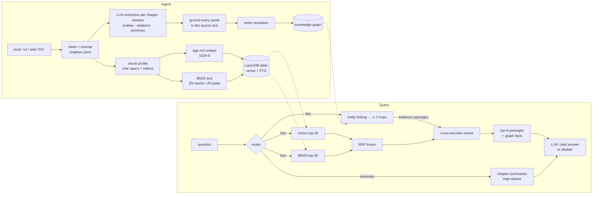

# novel_rag — hybrid vector + knowledge-graph RAG over books, with an evaluation harness

Ask grounded, cited questions about a book. The demo corpus is *The Adventures of Sherlock
Holmes* (public domain, 6 stories). The same pipeline runs on long Chinese novels (100–850
chapters, up to 1.9M characters), which are reported in [Multilingual](#8-multilingual-chinese).

No RAG framework is used. Every stage (chunking, embeddings, vector DB, BM25, fusion, reranking,
knowledge graph, prompting) is explicit and swappable, and **every design choice below was
decided by a measurement**.

**Headline (Sherlock, 188 synthetic questions, 168 answerable):** retrieval Recall@8 rises from
0.792 (vector only) to 0.899 with hybrid search plus a cross-encoder. End-to-end answer accuracy is
15.5% with no retrieval, 85.1% with RAG, and 86.3% with the knowledge graph added. The graph's gain
is all on multi-hop questions (58% to 71%: 4 wins, 0 losses on paired questions). Answers cite their
sources with 97% precision.

| Topic | Implementation | Code |
|---|---|---|
| Chunking | 5 pluggable profiles (fixed-token baseline, sentence-packed 256/512/1024, parent-child small-to-big), sized in the embedder's own tokenizer, with character offsets on every chunk | [`chunk/`](src/novel_rag/chunk/) |
| Vector DB | LanceDB (embedded, columnar): one table per (book, chunk profile); vectors, BM25 and SQL filters on one table; compaction and scalar indexes after bulk load | [`store/lancedb_store.py`](src/novel_rag/store/lancedb_store.py) |
| Retrieval | bge-m3 dense + BM25, fused with RRF, then the bge-reranker-v2-m3 cross-encoder, then optional parent expansion | [`retrieve/retriever.py`](src/novel_rag/retrieve/retriever.py) |
| Knowledge graph | LLM extraction with **source-grounding checks**, entity resolution that resists chaining errors, graph-augmented retrieval | [`kg/`](src/novel_rag/kg/) |
| RAG | follow-up rewriting, fact-vs-summary router, chapter-range filters, cited answers that abstain when the text is silent | [`generate/`](src/novel_rag/generate/) |
| Evaluation | synthetic QA with **character-span gold evidence** (scores any chunking), stage-by-stage retrieval ablation, LLM judge **checked against human labels**, closed-book baseline | [`eval/`](src/novel_rag/eval/), [`eval/RESULTS.md`](eval/RESULTS.md) |

---

## Architecture



**Corpora**

| | Sherlock Holmes (demo) | 西遊記 / Journey to the West | Contemporary Chinese web novel |
|---|---|---|---|
| Source | Gutenberg #1661, public domain | Gutenberg #23962, public domain | personal research copy, not redistributed |
| Size | 6 stories, 0.27M chars (~45k/story) | 100 chapters, 0.72M chars | 850 chapters, 1.86M chars |
| Eval set | 188 questions | 188 | 198 |
| Why | English demo; long chapters stress chunking | classical text every LLM has read | published after most training cutoffs, invented names |

---

## 1. Chunking

Every chunk records `[char_start, char_end)` inside its chapter and never crosses a chapter
boundary, so citations are exact. Budgets are counted in **bge-m3's own tokenizer**. The first
version counted with OpenAI's `cl100k`, so a "500-token" chunk was not 500 tokens to the embedder
or reranker; it also downloaded a vocabulary at import and hung offline. Each chapter is tokenized
once with offset mapping, so a per-sentence count is a binary search.

| profile | strategy | tests |
|---|---|---|
| `fixed-512` | sliding 512-token window, 12% overlap, ignores sentences | the naive baseline |
| `sent-256` / `sent-512` / `sent-1024` | split into sentences (English: `.!?` with abbreviation guards such as *Mr.*, *Dr.*; Chinese: `。！？；…` with closing quotes kept), pack whole sentences greedily, carry ≤12% overlap | sentence integrity; size sweep |
| `pc-128-768` | index 128-token children, hand the LLM the 768-token parent that contains the hit | small-to-big |

**Results (Sherlock, after reranking).** Recall@8 is the share of gold evidence found in the 8
passages given to the LLM. Recall@2k tok is the same, cut off at 2,000 tokens of context, which
compares strategies at **equal cost**: a 1024-token chunk covers more text but also costs the LLM
2× the context.

| profile | Recall@8 | Recall@2k tok | multi-hop Recall@8 | context tokens @8 |
|---|---|---|---|---|
| fixed-512 | 0.908 | 0.812 | 0.661 | 4,056 |
| sent-256 | 0.845 | 0.845 | 0.516 | 1,916 |
| **sent-512** (default) | 0.899 | **0.854** | 0.710 | 3,929 |
| sent-1024 | **0.929** | 0.729 | **0.806** | 7,991 |
| pc-128-768 | 0.857 | 0.688 | 0.613 | 5,989 |

What the numbers say, consistent across all three books:
- **Chunk size is a cost trade-off, not a free win.** 1024 wins Recall@8 only by sending twice the
  text; at equal context it is the worst. 256 and 512 tie at equal cost, but 256 loses multi-hop
  questions, whose evidence spans two places.
- **Sentence-aware packing did not beat fixed windows** at 512 tokens (0.899 vs 0.908 here, a tie
  on the Chinese books). With a 12% overlap, short evidence rarely straddles a boundary. The win is
  readability of the passages, not recall.
- **Parent-child underperformed.** 128-token children carry too little context for the embedder
  and cross-encoder to judge them, and parent de-duplication shrinks the candidate list.
- `sent-512` is the default: best recall per token of context.

## 2. Vector DB — LanceDB

- **Why LanceDB:** embedded (no server for a single-node app), columnar files on local disk or
  object storage, and vectors, full-text and SQL predicates on one table. One table per
  `(book, chunk profile)` (`chunks_<book>__<profile>`, plus `parents_…` for small-to-big) lets
  strategies be compared side by side.
- **Schema:** `id, vector[1024], text, text_norm (BM25 column), chapter_index, chapter_title, seq,
  token_count, char_start, char_end, parent_id`. Ids are deterministic (`book:chapter:seq`) and
  writes use `merge_insert`, so re-ingesting is idempotent and resumable.
- **Hybrid search, explicitly:** vector and BM25 run separately and are fused with Reciprocal Rank
  Fusion (`Σ 1/(60+rank)`), so each leg can be measured on its own.
- **Maintenance:** per-chapter upserts (needed for resumability) left 850 data fragments and
  ~13k files in a table; filtered scans took 40–100 s. After bulk load the store now compacts
  (850 → 1 fragment), prunes old versions, and builds the BM25 index plus BTREE scalar indexes on
  the filtered columns (`novel-rag optimize`), like `VACUUM` after a bulk load.
- **Sizing / index choice:** 1024 × float32 = 4 KB per vector. These tables hold 80–25k vectors,
  where an exact scan takes ~6 ms with perfect recall, so no ANN index is built.

  | chunks | raw vectors | exact scan | recommendation |
  |---|---|---|---|
  | 10⁴ (this repo) | 40 MB | ~ms | flat (exact) |
  | 10⁶ | 4 GB | 100s of ms | IVF_PQ (e.g. 1024 partitions, 64-byte codes ≈ 64 MB) + re-rank |
  | 10⁸ | 400 GB | impractical | IVF_PQ/HNSW on object storage, sharded; GPU index build |

## 3. Retrieval funnel

`vector top-30 ∥ BM25 top-30 → RRF → (+ graph evidence) → cross-encoder rerank → top-8`

| stage (Sherlock, sent-512) | Recall@1 | Recall@8 | MRR | multi-hop Recall@8 |
|---|---|---|---|---|
| vector only (bge-m3) | 0.440 | 0.792 | 0.608 | 0.484 |
| BM25 only | 0.479 | 0.836 | 0.645 | 0.597 |
| hybrid (RRF) | 0.536 | 0.851 | 0.691 | 0.613 |
| + cross-encoder rerank | **0.682** | **0.899** | **0.822** | 0.710 |
| + knowledge graph | 0.682 | 0.899 | 0.822 | 0.710 |

- **The reranker is the largest single gain:** about +15 points Recall@1 on every book. A
  cross-encoder reads question and passage together; two independently computed vectors cannot.
  It is also the cost: ~2.4 s for 30–40 candidates on a laptop GPU, versus ~6 ms for vector search.
- **Hybrid beats either leg alone.** BM25 is strong on proper names (Hosmer Angel, Briony Lodge),
  and vectors handle paraphrase.
- **BM25 by language:** English is lowercased, tokenized and stop-worded. Chinese is converted to
  Simplified (OpenCC) and segmented with jieba into a whitespace-separated column. jieba does not
  know invented names, so knowledge-graph names are added to its dictionary, identically at index
  and query time; the index metadata records it.
- **The graph adds nothing on this book, and that is expected.** Sherlock has only 160 chunks, so
  the 30+30 hybrid candidates already cover about a fifth of the book, and the graph's evidence
  passages are already in the pool. The graph pays off at scale: on the 850-chapter web novel it
  raised multi-hop Recall@8 by 5 points ([§8](#8-multilingual-chinese)).
- `retrieve(..., collect_stages=True)` returns the ranking after every stage in one pass, which is
  how the table above is produced. 95% bootstrap CI for Recall@8 after reranking: 0.86–0.94.

## 4. Knowledge graph

```
chapter ─ split into ≤9k-char windows ─ LLM (MiniMax-M3.1-Flash), 1 call per window ─▶
  {summary, entities[name, type, aliases, description], relations[head, type, label, tail, evidence quote]}
─ grounding ─▶ drop entities whose names don't occur in the chapter;
               drop relations whose quote can't be located in the source (exact or ≥60% fuzzy)
─ resolution ─▶ global entities + typed, weighted edges, each pointing to a source span
```

Sherlock: 35 LLM calls → 210 entities and 220 edges. 260 relations were grounded (241 exact,
19 fuzzy) and 10 dropped as unsupported.

**Grounding.** LLM output is not trusted. Models add famous characters from memory, so an entity
survives only if it literally occurs in the chapter, and an edge only if its quote is found in the
source. The stored span turns every edge into a pointer to a passage.

**Entity resolution** is the hard part. One character has many names (Holmes / Mr. Sherlock
Holmes; Irene Adler / Miss Adler / Madame / "the late Irene Adler"; in 西遊記, 孫悟空 has 20+ names).
Resolution is union-find over the (name, alias) pairs the extractor emits, and naive union-find
failed badly. One wrong alias in one chapter chains two large clusters: the first build merged
唐三藏 with 沙僧, 玉帝 and 牛魔王, and in the web novel merged the protagonist with his wife, his
rival and his father. Each guard below fixes an observed failure:

1. Links are applied strongest first, weighted by how many chapters assert them.
2. Two clusters that both contain an *established* name (a primary name in ≥3 chapters) need ≥3
   chapters of evidence to merge; any two named clusters need ≥2. LLM alias errors are almost
   always one-offs.
3. **Cannot-link:** if two clusters were extracted as *separate* entities in the same chapters more
   often than half the evidence for merging them, they stay apart. This is what scaled to 850
   chapters, where the protagonist (in 835 chapters) collects a few wrong aliases.
4. An alias is ambiguous when the names it links fall into groups that are not linked to each
   other ("the King", 國王, 老魔). Ambiguous aliases never merge.
5. Pronouns, bare titles and possessive descriptors ("my dear fellow", 師父) never link. Male
   honorifics are folded (Dr. Watson = Watson) but Mrs./Miss are not: one story has both Mr. Turner
   and Miss Turner.

**Graph-augmented retrieval.** The question is scanned for any known name (longest match, whole
words), so *"How did Irene Adler outwit Holmes?"* links to two entities. The graph returns their
direct edges (or the ≤2-hop path), plus each entity's most relevant edges. Relevance is
**question-aware**: the other endpoint being mentioned, then word overlap between the question and
the edge's labels and evidence quotes. The first version ranked edges by frequency alone, so a hub
like Holmes always returned his generic edges. Measured on the 850-chapter web novel, query-aware
ranking lifts multi-hop Recall@8 of the graph-fused list from 0.613 to 0.637 before reranking; after
the cross-encoder both versions land at 0.675, so the reranker absorbs the difference. Output: compact facts for the
prompt, plus the edges' evidence passages **added to the rerank pool**. The graph proposes passages
about the right entities even when they share no wording with the question, and the cross-encoder
still decides.

## 5. Generation

- **Router:** whole-book questions ("summarize the book") go to a map-reduce over the chapter
  summaries the graph step produced; everything else goes through retrieval. Inline chapter ranges
  ("chapters 2-4 …") become filters.
- **Follow-ups** are rewritten into standalone questions using the chat history.
- **Prompt rules:** answer only from the passages, cite `[chapter title]`, and say *"I can't
  determine this from the text"* when the passages are silent. Graph facts are labelled as
  orientation only. Prompts follow the question's language (English or Chinese).
- **LLM plumbing:** OpenAI-compatible client (MiniMax); hidden `<think>` blocks stripped, including
  across streamed chunks; a SQLite response cache keyed on (model, messages, parameters), so eval
  re-runs are reproducible and free; per-call token metering; a thread pool for batch jobs.

---

## 6. Evaluation

### Gold set

[`eval/dataset.py`](src/novel_rag/eval/dataset.py) generates the set synthetically, and each design
choice closes a known hole in synthetic RAG benchmarks:

| problem with naive synthetic QA | what this harness does |
|---|---|
| labels are chunk ids, so chunkers can't be compared | gold evidence is `(chapter, char_start, char_end)`; a chunk counts if it covers ≥50% of a span, so any chunking is scored on the same questions |
| the generator hallucinates its "evidence" | the evidence must be quoted verbatim and located in the source, or the item is dropped |
| questions copy the source wording, flattering BM25 | items sharing ≥5 consecutive words (≥8 CJK characters) with the evidence are dropped, as are items whose answer appears in the question |
| only single-passage questions | **multi-hop:** two graph edges sharing a "bridge" entity, evidenced far apart; the question needs both passages |
| "I don't know" is never tested | **unanswerable:** plausible questions about real characters, kept only if retrieval plus an LLM check find no supporting passage |
| LLM-graded and never checked | a sample is reviewed by a person ([`ui/eval_review.py`](src/novel_rag/ui/eval_review.py)); judge-vs-human agreement is reported as Cohen's κ |
| the model may already know the book | **closed-book** baseline: same LLM, no retrieval |

Sampling is stratified by position across the book, so long chapters get proportionally more
questions. Generation uses a fast model (`MiniMax-M3.1-Flash`) and the response cache, so the set is
reproducible. Sherlock: 188 questions (137 single-hop, 31 multi-hop, 20 unanswerable) from 150 calls.

### Metrics

- **Retrieval** ([`eval/metrics.py`](src/novel_rag/eval/metrics.py)): Recall@k (share of gold spans
  covered, which matters for multi-hop), MRR, nDCG@10 (a chunk only earns credit for evidence not
  yet covered, so near-duplicates aren't rewarded), Recall at a 2,000-token budget, p50/p95 latency
  per stage, and 95% bootstrap confidence intervals.
- **End to end** ([`eval/e2e.py`](src/novel_rag/eval/e2e.py)): the same questions under three
  configurations (closed-book, hybrid+rerank, hybrid+rerank+graph). The generator is
  `MiniMax-M3.1-Flash` at temperature 0; a stronger model (`MiniMax-M3`) judges, so the judge is
  not grading its own output. The judge grades correctness (0/1/2
  against the reference), abstention, and faithfulness (every claim supported by the passages the
  system actually saw). Citation precision/recall is computed deterministically from the cited
  chapter titles.

### Results (Sherlock)

| config | accuracy (95% CI) | single-hop | multi-hop | abstains when unanswerable | false abstention | faithfulness | citation P / R | retrieval p50 |
|---|---|---|---|---|---|---|---|---|
| closed-book (no retrieval) | 15.5% (10.1–20.8) | 16.1% | 12.9% | 45% | 6.0% | — | — | — |
| hybrid + rerank | 85.1% (79.8–89.9) | **91.2%** | 58.1% | 80% | 5.4% | **94.0%** | **97.2%** / 93.8% | 2.5 s |
| hybrid + rerank + graph | **86.3%** (81.0–91.1) | 89.8% | **71.0%** | **85%** | **3.0%** | 92.9% | 96.5% / **94.9%** | 2.5 s |

Generator `MiniMax-M3.1-Flash`, judge `MiniMax-M3`, chunks `sent-512`, top-8 passages. Accuracy =
judge score 2 ("fully correct") on the 168 answerable questions.

What this shows:
- **The model doesn't already know these stories in enough detail.** Closed-book scores 15.5%, so
  the 85% comes from retrieval, not memory.
- **The graph helps where it should.** It adds nothing to passage recall once the reranker runs
  (table in §3), but the extracted relation facts in the prompt fix multi-hop answers: 4 questions
  flip to correct, none flip to wrong. With 31 multi-hop questions this is a direction, not a
  significant result (one-sided sign test p≈0.06).
- **Grounding is high.** 93–94% of answers have every claim supported by the passages shown, and
  97% of citations point to a story that holds gold evidence. Faithfulness drops by about one point
  with the graph, because the facts themselves become a second source the judge can't check
  against passages.
- **Most remaining errors are retrieval errors.** Of the 23 answerable questions not fully correct
  (graph config), 15 lacked gold evidence in the top 8: 6 single-hop misses, and 9 multi-hop where
  one or both spans were missing. In the other 8 the evidence was retrieved and the generator
  answered wrong or incompletely. Multi-hop recall is the next thing to fix.
- Retrieval latency is almost all cross-encoder (~2.4 s per query on a laptop GPU); the graph
  lookup adds under 30 ms.

The judge is checked against human labels with `novel-rag eval calibrate` (agreement and Cohen's
kappa on a labeled sample).

---

## 7. From prototype to production

**Already built for operability**
- *Resumable, idempotent pipelines:* every phase checkpoints to disk; deterministic ids plus
  `merge_insert` make re-runs safe; the evaluator saves after each chunk profile and skips finished
  ones.
- *Lineage:* each index records its embedder, dimension, chunk profile and BM25 dictionary, and a
  query with a mismatched embedder fails loudly instead of returning garbage. Graph files record
  model and prompt version; the eval set records generator, prompt version and seed.
- *Cost and latency telemetry:* per-call token metering; the response cache (re-generating an eval
  set: 148/148 cache hits, no cost); per-stage timings on every query, shown in the UI and reported
  as p50/p95 by the evaluator.
- *Evaluation as a regression gate:* every decision in this README came from
  `novel-rag eval retrieval|e2e`; the same commands can gate CI on a fixed question subset.

**Measured sizing (Apple M4 laptop GPU)**

| item | value |
|---|---|
| graph extraction | 1 call per ≤9k-char window, ~15 s each, 8 in parallel. Sherlock: 35 calls (83k prompt + 73k completion tokens). 850-chapter web novel: 856 calls (1.9M + 1.7M tokens) |
| eval-set generation | ~150 calls per book (≈240k prompt + 56k completion tokens) |
| embedding + indexing | 0.27M chars: ~1 min per profile; 1.9M chars: 4–9 min |
| query latency | embed ~40 ms · vector ~6 ms · BM25 ~6 ms · graph <30 ms · rerank 0.5–5 s · LLM ~6 s |

**What would change in production**
- *Serving:* embedder and reranker as GPU inference services on Kubernetes with autoscaling. The
  reranker dominates retrieval latency, so batch candidates, cap passage length, or distil a smaller
  cross-encoder. LLM calls go through a gateway with retries, budgets and fallbacks.
- *Storage:* LanceDB tables on object storage shared by stateless query pods; ANN indexes past
  ~10⁵–10⁶ vectors; compaction and index builds as scheduled jobs, off the query path.
- *Ingestion:* parsing, embedding and graph extraction as separate batch jobs with queues and rate
  limits; incremental updates re-embed only changed chapters (deterministic ids make that a diff).
- *Observability:* per-stage timings become OpenTelemetry spans; sample production traffic and run
  the faithfulness judge on it to catch drift.
- *Governance:* provenance on every chunk and edge (already there via character spans), per-corpus
  access control, PII screening at ingest.

---

## 8. Multilingual (Chinese)

The same code handles Chinese: language is detected per text, which switches sentence splitting,
BM25 tokenization and prompts. Retrieval results on the two Chinese books (default `sent-512`):

| stage | 西遊記 Recall@8 | web novel Recall@8 | web novel multi-hop |
|---|---|---|---|
| hybrid (RRF) | 0.702 | 0.713 | 0.550 |
| + rerank | 0.818 | 0.809 | 0.625 |
| + graph (v1 ranking) | 0.830 | 0.820 | 0.675 |

The same conclusions hold. The reranker is the largest gain. 256 and 512 tie at equal context
(Recall@2k tok 0.74–0.75 on both books). 1024 wins Recall@8 (0.85) only with ~7.9k tokens of
context. Parent-child underperforms. The graph helps most on multi-hop questions over the
850-chapter novel (+5 points). Full tables: [`eval/RESULTS.md`](eval/RESULTS.md).

---

## Running it

```bash
uv sync && cp .env.example .env            # add MINIMAX_API_KEY

curl -L -o data/corpora/sherlock.txt https://www.gutenberg.org/cache/epub/1661/pg1661.txt
uv run novel-rag ingest-file data/corpora/sherlock.txt --novel-id sherlock \
    --title "The Adventures of Sherlock Holmes" --heading roman --limit 6
uv run novel-rag kg build sherlock                   # entities, relations, chapter summaries
uv run novel-rag reindex sherlock --profile all      # every chunk profile (+ compaction)

uv run novel-rag search "Who is Irene Adler?" --novel-id sherlock --debug   # every stage + graph facts
uv run novel-rag ask "Why did the King of Bohemia want the photograph back?" --novel-id sherlock
uv run streamlit run src/novel_rag/ui/streamlit_app.py                     # chat UI

# evaluation
uv run novel-rag eval gen sherlock                   # synthetic QA set (cached LLM calls)
uv run novel-rag eval retrieval sherlock             # chunk profiles x stages
uv run novel-rag eval e2e sherlock --profile sent-512
uv run streamlit run src/novel_rag/ui/eval_review.py # human labels
uv run novel-rag eval calibrate sherlock && uv run novel-rag eval report sherlock,xiyouji
```

Chinese: `ingest-file <xiyouji.txt> --novel-id xiyouji` (default `第X回` headings), or
`ingest <TOC-url> --kg` for a web novel (polite single-threaded scraper with an HTML cache).

**Git-ignored state** (`.env`, `data/` with indexes, graphs and LLM cache, per-question eval dumps)
is kept out of the repo. The maintainer restores it from a private S3 bucket:
`scripts/bootstrap.sh` on a fresh clone (dependencies + ignored files + models), and
`scripts/ignored-sync.sh push|pull|list` afterwards. Without bucket access, rebuild with the
commands above; the LLM cache only makes reruns free.

## Project layout

```
src/novel_rag/
  chunk/      chunker.py (profiles, spans, EN/ZH sentences) · tokens.py (embedder-tokenizer counting)
  store/      lancedb_store.py (table per profile, hybrid search, RRF, compaction, span lookups)
  retrieve/   retriever.py (staged funnel, router, range filters, parent expansion)
  rerank/     reranker.py (cross-encoder)
  kg/         extract.py (windowed LLM extraction + grounding) · resolve.py · retrieve.py (graph RAG)
  generate/   llm.py (client, cache, metering) · prompts.py (EN/ZH) · rag.py (engine)
  eval/       dataset.py · metrics.py · retrieval.py · e2e.py · report.py
  pipeline/   ingest.py · query.py      parse/ scrape/ ui/ (chat + eval review)
eval/         datasets/ · results/ · labels/ · RESULTS.md
```

## Legal / ethical note

Sherlock Holmes and 西遊記 are public domain (Project Gutenberg). The Chinese web novel's
`robots.txt` disallows non-search crawlers. The scraper exists for personal offline research only:
custom User-Agent, single-threaded with delays, an HTML cache so re-runs never re-fetch, and a
`SCRAPE_ENABLED=false` kill switch. None of that grants permission, so that corpus and every eval
file containing its text stay out of the repository.
